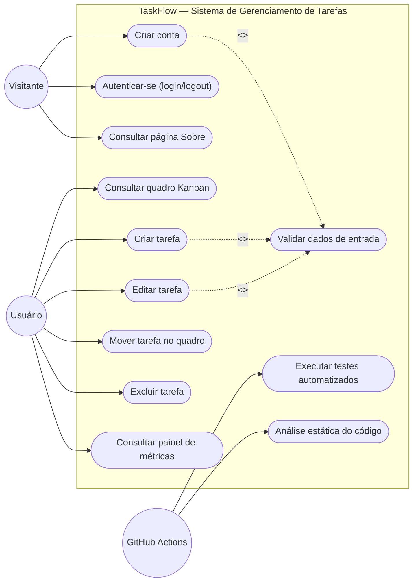
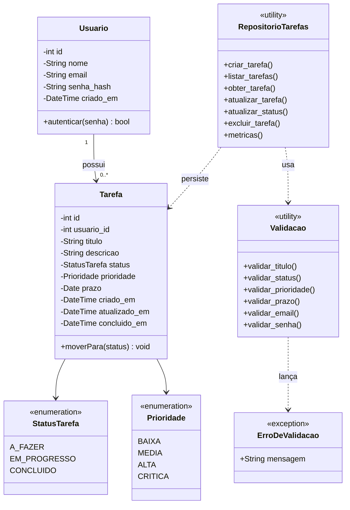

# Diagramas UML do TaskFlow

Versões em imagem (para o documento teórico):
[`casos-de-uso.png`](casos-de-uso.png) e [`classes.png`](classes.png).

## 1. Diagrama de Casos de Uso

## 2. Diagrama de Classes

